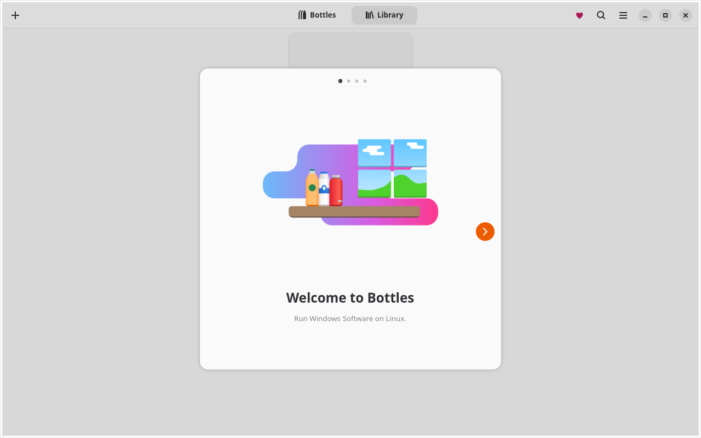

# Bottles on aarch64 (Asahi) — muvm + cpak

`modules/packages/bottles-asahi.nix` is the whole integration: it defines the
`programs.bottles-asahi` option and the `bottles-asahi` /
`bottles-asahi-install` wrappers, and turns on `services.cpak` and
`hardware.graphics`. There is no separate package file.

```bash
bottles-asahi-install     # first run: fetch Bottles into the guest store
bottles-asahi             # launch (GUI + Windows apps run in the microVM)
bottles-asahi --install   # later: update Bottles
bottles-asahi --debug     # same, with GSK_GDK renderer tracing
```

## Why this shape

### There is no supported path to copy

Fedora Asahi Remix — the distro Asahi Linux itself supports — does **not**
support Bottles, or Windows apps outside Steam at all:

> "At this point, we do not support running Windows apps outside of Steam as
> non-proton Wine not yet work on Fedora. We are working on resolving the
> underlying [FEX issue](https://github.com/FEX-Emu/FEX/pull/4225)."
> — <https://docs.fedoraproject.org/en-US/fedora-asahi-remix/x86-support/>

The same page says Wayland is not supported inside the VM, and the muvm
announcement says Flatpak does not integrate with FEX/muvm. What Fedora gives
users is `dnf install steam` plus `muvm -- <x86-64 binary>`.

Bottles itself:

| route | works here? |
| --- | --- |
| Flathub `com.usebottles.bottles` | **No** — x86_64 only (`org.gnome.Platform/x86_64/50`); the aarch64 request was closed *not planned*. |
| Fedora `bottles` package | Exists (`noarch`, still 52.0), but it is an x86 desktop app: on aarch64 it needs FEX, which Fedora does not support for Wine yet. |
| nixpkgs `bottles` / `bottles-unwrapped` | **No** — fails to *evaluate* on `aarch64-linux`: `buildFHSEnv` with `multiArch = true` needs `pkgsi686Linux`, which does not exist outside x86 (`error: i686 Linux package set can only be used with the x86 family`). |
| cpak arm64 release | **Yes** — upstream's only arm64 packaging (Bottles 67.3 release notes: "Added the ARM64 Cpak package with Soda runner support"), with the Soda ARM64/ARM64EC runner. |

So the integration has to be invented, and cpak is the base it has to be built
on.

### It has to run under muvm

This host runs a **16 KiB page size** kernel (`getconf PAGESIZE` → 16384).
Bottles runs Windows binaries through FEX, and FEX needs 4 KiB pages — hence
muvm's microVM with its own 4 KiB guest kernel, the same mechanism
`programs.steam-asahi` uses. Inside muvm the GPU is not virgl/venus: muvm uses
the **DRM native context** for Asahi, so the guest runs the real `asahi` Mesa
driver against the host's kernel driver. `glxinfo` inside the guest reports
`Apple M2 (G14G G0)` with direct rendering.

### cpak needs a real filesystem inside the guest

cpak composes an application root with a **rootless OverlayFS** mount. The
guest's root is virtiofs (a FUSE-derived filesystem), and overlayfs refuses a
FUSE filesystem as upperdir:

```
[FAIL] rootless OverlayFS: mount: .../merged: cannot mount overlay read-only.
```

cpak has a `fuse-overlayfs` fallback, but it is only taken on
`EPERM`/`EACCES`, and `/dev/fuse` in the guest is `0600 root`. The fix is to
give cpak a filesystem overlayfs accepts — a **loop-mounted ext4 image**:

1. The wrapper creates a sparse image at
   `~/.local/share/bottles-asahi/store.img` (64 GiB max, grown on demand) in
   the **real** `$HOME`, so installed applications survive VM restarts.
2. muvm's `-x` pre-command (root) attaches it (`losetup` → `mkfs.ext4` on
   first run → `mount`) at `/run/bottles-asahi/store` and hands the mount to
   the invoking user.
3. `CPAK_INSTALLATION_PATH=/run/bottles-asahi/store/cpak` puts cpak's whole
   installation (store, layers, composed roots, cache, exports) on ext4.

Verified inside muvm with this setup:

```
[OK]   unprivileged user namespaces
[OK]   rootless OverlayFS: overlay mount with userxattr succeeded
[OK]   mount_setattr / seccomp / X11 display / PipeWire
[FAIL] Landlock: function not implemented
```

Landlock is optional (the libkrunfw guest kernel has no LSM), and Bottles'
manifest disables it.

## The two bugs this module exists to fix

### 1. The black window

cpak's `displayX11` isolation starts a **nested Xephyr** for the app and runs
the app in a **private IPC namespace**. Xephyr lives in the guest's namespace,
so every SysV shared-memory transfer between them fails — visible in the
application log:

```
libEGL warning: DRI3 error: Could not get DRI3 device
MESA: info: vulkan: No DRI3 support detected - required for presentation
MESA: error: Failed to attach to x11 shm        (x4)
```

Xephyr has no DRI3, so GTK4's GSK GL renderer falls back to llvmpipe — and
GTK itself notes `Not using GL: renderer is llvmpipe` — while its presentation
path needs exactly the SHM that the namespace split breaks. The result is a
pure black 1280×800 Xephyr window while the app is alive and has finished
starting ("Bottles Started!", catalog loaded, library saved).

The module forces `GSK_RENDERER=cairo` for the app. The UI is software
rendered either way (there is no GPU path through Xephyr), so nothing is lost;
the GL/SHM path that produces the black window is simply not used. Set
`BOTTLES_GSK_RENDERER=gl` (or `vulkan`) to experiment. This only affects
Bottles' own GTK window: Wine/DXVK rendering happens in the bottle's process
and is untouched.

Diagnostic proof: with the same launch and `GSK_DEBUG=renderer`, cairo logs
`Using renderer 'GskCairoRenderer'`, the `x11 shm` errors disappear, and the
window renders the full "Welcome to Bottles" UI.

### 2. Lost bottles and library

cpak's manifest maps `$HOME/.local/share/bottles` and
`$HOME/.local/share/icons` from the host. But cpak launches the app with
`XDG_DATA_HOME` pointing at *its own store*, so Bottles wrote its data into the
container's writable layer — which cpak deletes with the container. Every
launch looked like a fresh install:

```
Data file not found. Creating new one.
Library file not found, creating new one
```

The module pre-creates the two mount points and passes
`--env XDG_DATA_HOME=$HOME/.local/share` to the app, so the library, bottles
and their prefixes land in the mapped, persistent directory. Verified:
`~/.local/share/bottles/{library.yml,data.yml,journal.yml,bottles/,dxvk/,...
}` is created on the host and is still there on the next launch.

## Where things live

| what | where |
| --- | --- |
| cpak store, layers, composed roots | ext4 image `~/.local/share/bottles-asahi/store.img`, mounted at `/run/bottles-asahi/store` inside the guest |
| Bottles data, bottles, DLL overrides | real `$HOME/.local/share/bottles` |
| Bottles icons | real `$HOME/.local/share/icons` |
| per-run microVM state | guest-private `/run`, discarded |

The 64 GiB figure is the maximum: the image is sparse, and only data actually
written (a few GiB for Bottles plus its Wine runner) occupies disk.

## Runtime details

* muvm exposes **X11 only** (its bridge to the host's XWayland). The runtime
  clears `WAYLAND_DISPLAY` (so cpak takes its Xephyr branch instead of looking
  for a compositor) and pins `GDK_BACKEND=x11`.
* A **session D-Bus** is started inside the guest and exported as
  `DBUS_SESSION_BUS_ADDRESS`. cpak starts a `desktop-bus-proxy` whose upstream
  is that variable, and waits 3 s for it before failing with
  `start desktop bus proxy: no cpak service answered ...`.
* The wrapper holds an exclusive `flock` on
  `~/.local/share/bottles-asahi/.lock` for the guest's lifetime; two guests
  must never attach the same ext4 image.
* `XDG_RUNTIME_DIR` is repointed at `$XDG_RUNTIME_DIR/bottles-asahi-muvm` so
  this microVM cannot collide with `steam-asahi`'s or `cadence-env`'s.
* The wrapper creates `~/.local/share/bottles` and `.local/share/icons` before
  every launch — cpak silently skips a manifest mount whose source is missing.

## Caveats

* **File pickers and host integration are degraded.** cpak's file-chooser
  broker and desktop-dialog adapters are host services; the guest has no
  system authority and no system D-Bus.
* **Verified launch is not available** (`cpak install` warns: "no system
  authority is reachable"). Enrollment is optional and off by default.
* **Performance** is FEX emulation inside a microVM — the Steam-on-Asahi class,
  plus Wine overhead. Bottles' own UI is cairo (software) by design.
* **First launch is slow**: Bottles downloads its Soda runner and FEX from its
  component catalog into the image.
* Windows-app support inherits the FEX/Bottles state: cpak ships Soda ARM64
  and its own FEX, but this is upstream's arm64 test release, not something
  Asahi or Bottles support.

## Status (2026-10)

* New single module evaluates and builds on the macbook
  (`nixosConfigurations.macbook` evaluates; the package derivation builds).
* `bottles-asahi` launches inside muvm, and the GUI renders the first-run
  wizard (captured from the guest's Xephyr display with
  `GSK_RENDERER=cairo`; the same run without cairo is the black window):

  
* Bottles' library and data persist in `~/.local/share/bottles` across runs.
* Not exercised yet: creating a bottle and running an x86/x86_64 Windows
  application through the Soda runner (downloads the runner into the image;
  that is the real FEX test).
